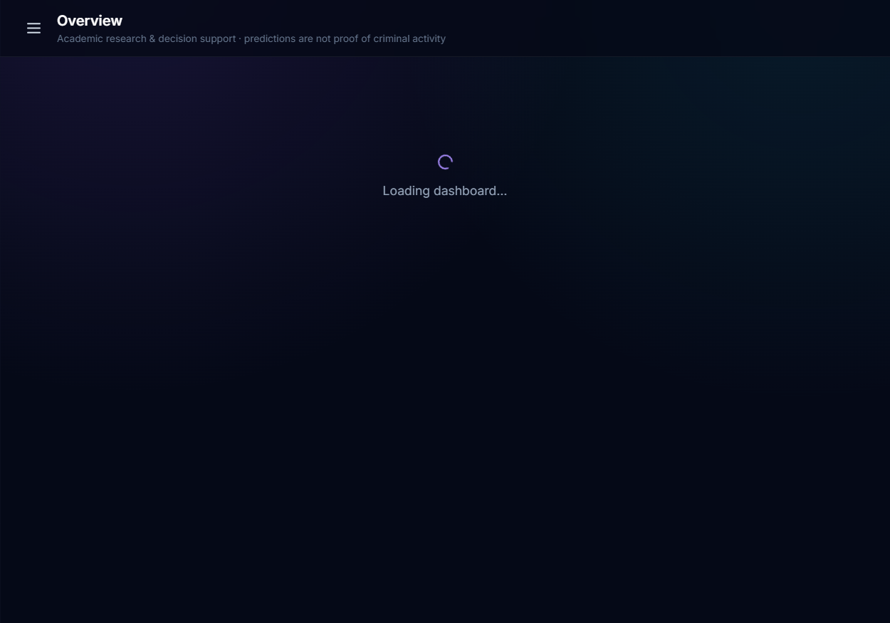
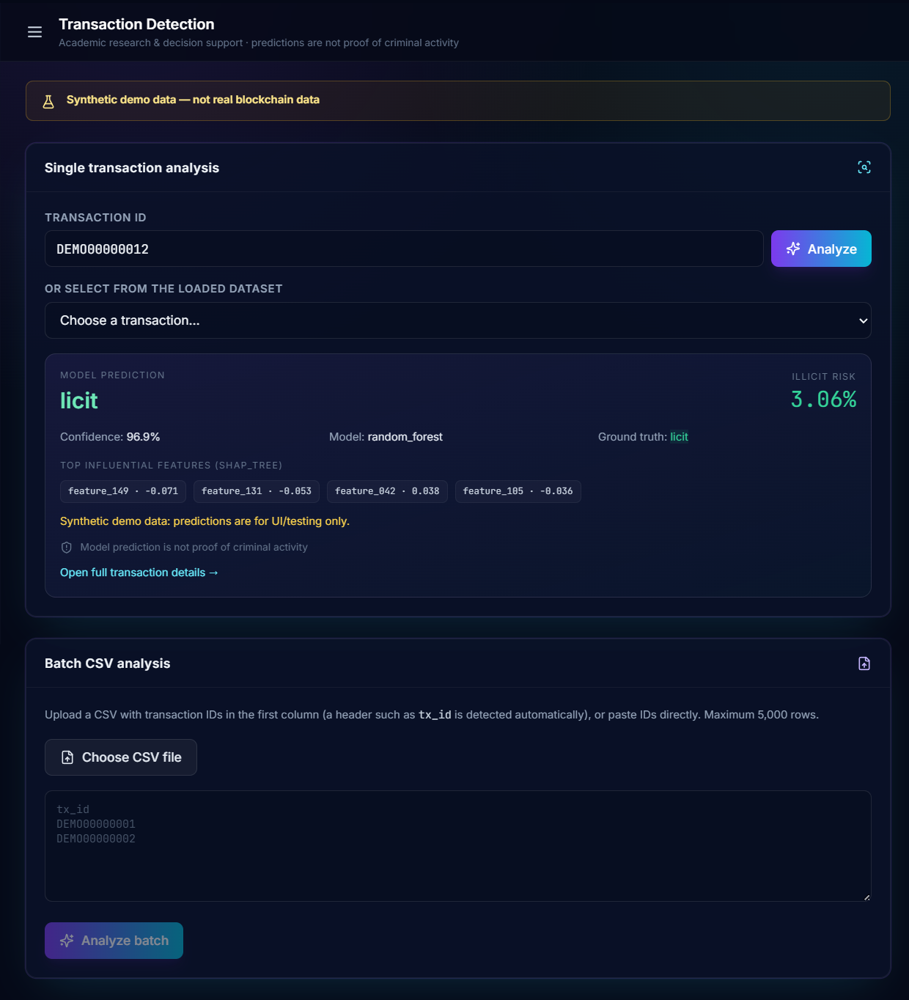
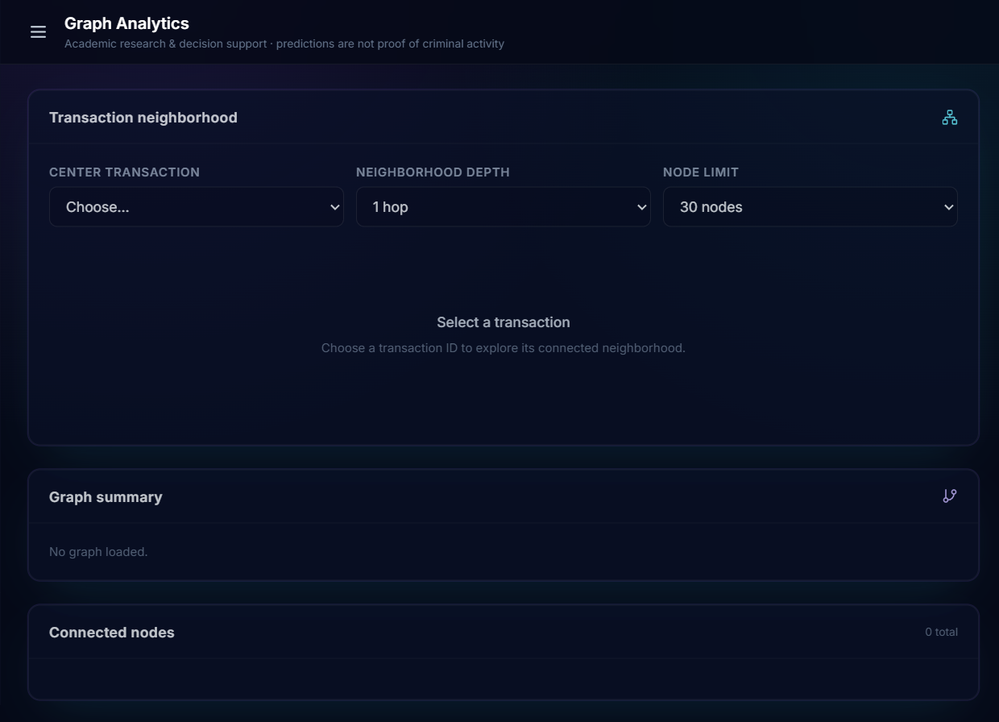
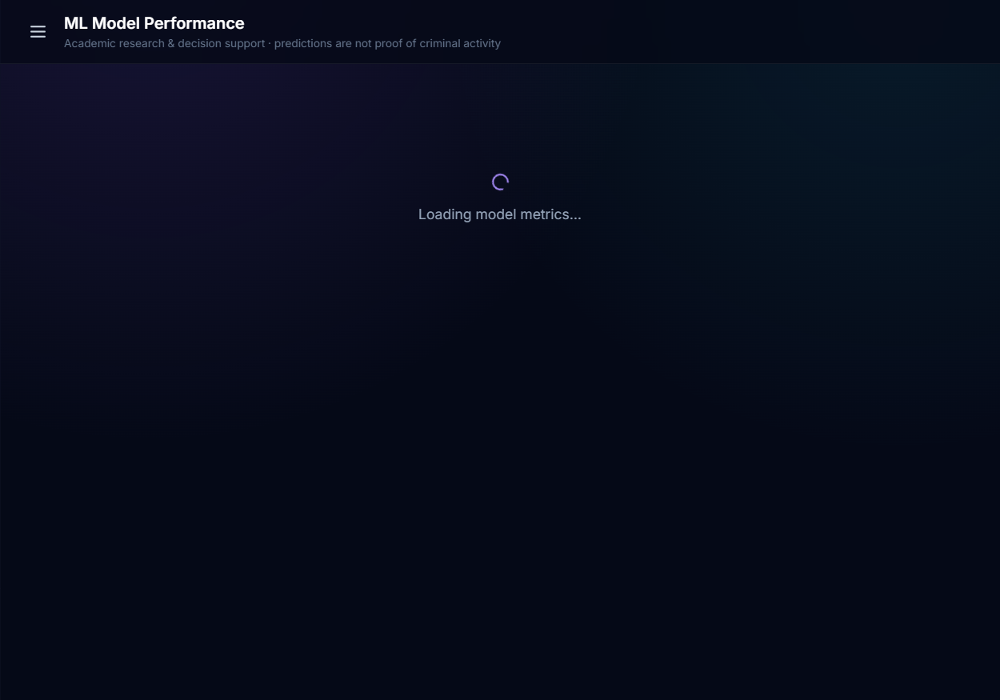

# Sentinel Chain — Machine Learning-Based Illicit Transaction Detection on the Bitcoin Blockchain

An academic, full-stack research dashboard for **machine-learning-assisted analysis** of illicit transaction patterns in the public Elliptic Bitcoin data set. The application combines supervised ML, temporal graph analytics, privacy-aware identifiers, opt-in Web3 explorer lookups, and a polished React dashboard.

> **Important:** This is decision-support software for research and education. A model prediction is **not proof of criminal activity**, not legal evidence, and not an accusation about any person or entity. Every prediction response and report carries that warning.

## Submission summary

This submission delivers a working full-stack React/FastAPI research dashboard for machine-learning-assisted analysis of illicit transaction patterns, with temporal ML evaluation, NetworkX graph analytics, SQLite persistence, and an academic privacy-first interface. In the submitted environment the official Elliptic CSVs are not present, so the application runs in a clearly labelled **synthetic demo mode**; a Random Forest classifier trained on the deterministic demo data is deployed with held-out test precision, recall, F1, PR-AUC and ROC-AUC of `1.000` (confusion matrix `26 / 0 / 0 / 3`), and every UI/API response states that predictions are decision support, not proof of criminal activity. The same loader and training pipeline accepts the real Elliptic CSVs through `docs/KAGGLE_SETUP.md`, and the repository includes 27 backend tests, 8 frontend tests, a passing production build, and a 13-endpoint API smoke test.

---

## 1. What is included

| Layer | Implementation |
| --- | --- |
| Frontend | React 18 + TypeScript + Vite + Tailwind CSS, React Router, Recharts, Lucide icons, responsive dark Web3-security UI |
| Backend | FastAPI + Pydantic v2, structured error responses, CORS, OpenAPI/Swagger docs |
| ML | pandas/numpy/scikit-learn pipeline, optional XGBoost, optional SHAP, temporal train/validation/test split, class weighting, calibration |
| Graph | NetworkX directed graph, leak-free temporal edges, bounded neighborhood subgraphs and graph-derived features |
| Storage | SQLite via SQLAlchemy: transactions cache, predictions, metrics, analysis history, preferences |
| Privacy/Web3 | Masked IDs, redacted logs, BTC txid validation, configurable explorer URL, disabled-by-default live lookup, no keys or personal data |
| Demo mode | Deterministic **synthetic** dataset with `DEMO########` IDs and an explicit notice; auto-trains a small model on first start |
| Tests | 27 backend pytest tests + 8 frontend Vitest/React Testing Library tests |
| Docs | Architecture, model methodology, API reference, Kaggle setup, results/screenshots placeholders |
| Containers | Multi-stage backend Dockerfile (serves built frontend), frontend dev Dockerfile, Docker Compose |

---

## 2. Quick start (demo mode — no Kaggle account needed)

### Prerequisites

- Python 3.10+ (3.11/3.12 recommended)
- Node.js 18+
- Git (optional)

On Windows PowerShell, `npm` may be blocked by execution policy. Use `npm.cmd` and `npx.cmd` instead.

### Install

```bash
# From the project root
python -m pip install -r backend/requirements.txt
cd frontend
npm.cmd install
cd ..
```

Optional: install XGBoost to add another candidate model.

```bash
python -m pip install xgboost
```

### Generate the labelled synthetic demo dataset

```bash
python scripts/generate_demo_data.py
```

This writes `data/processed/demo/demo_txs_*.csv` plus `README_SYNTHETIC_DATA.txt`. The generator is deterministic (`RANDOM_STATE=42` by default). **These records are simulated and are not Bitcoin observations.**

### Start the backend

```bash
python -m uvicorn app.main:app --app-dir backend --reload
```

- API: <http://127.0.0.1:8000>
- Swagger docs: <http://127.0.0.1:8000/docs>
- Health: <http://127.0.0.1:8000/api/health>

With `AUTO_TRAIN_DEMO=true` (default) and no existing `models/model_bundle.joblib`, the backend trains a small synthetic model during startup so all prediction pages work immediately.

### Start the frontend

```bash
npm.cmd run dev --prefix frontend
```

Open <http://localhost:5173>. The Vite proxy forwards `/api` to `http://127.0.0.1:8000`.

### Verify the stack

```bash
python scripts/verify_api.py
```

This calls every required endpoint and checks that prediction responses include the safety warning.

---

## 3. Using the real Elliptic data set

1. Follow [`docs/KAGGLE_SETUP.md`](docs/KAGGLE_SETUP.md) to accept the Kaggle dataset terms and download the CSVs.
2. Place these files in `data/raw/`:

   ```text
   data/raw/elliptic_txs_features.csv
   data/raw/elliptic_txs_classes.csv
   data/raw/elliptic_txs_edgelist.csv
   ```

   The loader also detects common header variants and compressed files can be extracted with the provided script.

3. Copy `.env.example` to `.env` and set:

   ```env
   DATASET_SOURCE=elliptic
   AUTO_TRAIN_DEMO=false
   ```

   `DATASET_SOURCE=auto` also works: the loader prefers complete real CSVs when present and falls back to synthetic demo data otherwise.

4. Train and evaluate. Automatic selection uses validation PR-AUC:

   ```bash
   python backend/ml/train.py --source elliptic
   ```

   To deploy Random Forest explicitly (recommended for the demo dashboard):

   ```bash
   python backend/ml/train.py --source elliptic --model random_forest
   ```

5. Restart the API. The frontend will show **Elliptic historical** rather than the synthetic-data banner.

The Kaggle dataset is historical and anonymized. Its identifiers are opaque research IDs, **not** live Bitcoin transaction hashes.

---

## 4. Tests and production build

```bash
# Backend
python -m pytest -q

# Frontend unit tests
npm.cmd --prefix frontend run test

# Frontend production build
npm.cmd --prefix frontend run build
```

The built dashboard is written to `frontend/dist/`. The backend automatically mounts that directory at `/` when it exists, so a single backend process can serve both the API and the compiled UI.

Docker alternative:

```bash
docker compose up --build
# UI: http://localhost:5173  API: http://localhost:8000
```

---

## 5. Dashboard pages

| Route | Purpose |
| --- | --- |
| `/` | Overview KPIs, class mix, risk distribution, recent transactions |
| `/detect` | Single-transaction prediction and CSV batch prediction with explanations |
| `/explorer` | Searchable, sortable, filterable transaction table with pagination and ID masking |
| `/transactions/:id` | Feature values, graph neighborhood, explanation, risk indicators, relationships |
| `/graph` | Interactive bounded neighborhood visualization with depth/node limits |
| `/models` | Model comparison, confusion matrix, temporal-split metrics, retrain button |
| `/temporal` | Transaction volume and illicit-rate trends by time step |
| `/privacy` | Privacy principles, explorer links, opt-in live lookup |
| `/settings` | Safe preference controls; credentials are explicitly never accepted |

---

## 6. API summary

All routes are prefixed with `/api`. Full request/response schemas are available at `/docs`.

| Method | Endpoint | Description |
| --- | --- | --- |
| `GET` | `/health` | Status, version, dataset source, synthetic flag, model availability |
| `GET` | `/dashboard/summary` | Aggregate counts and headline model indicators |
| `GET` | `/transactions` | Filtered/sorted paginated transaction list |
| `GET` | `/transactions/{tx_id}` | Transaction detail with features and relationships |
| `POST` | `/predict` | Single prediction with explanation and safety warning |
| `POST` | `/predict/batch` | Up to 5,000 IDs or inline CSV content |
| `POST` | `/predict/batch/upload` | Multipart CSV upload |
| `GET` | `/transactions/{tx_id}/graph` | Bounded colored neighborhood subgraph |
| `GET` | `/transactions/{tx_id}/explanation` | Feature attribution for a stored or generated prediction |
| `GET` | `/models/metrics` | Validation comparison and held-out test metrics |
| `POST` | `/models/train?source=demo` | Retrain and refresh cached scores |
| `GET` | `/analytics/temporal` | Per-time-step counts and illicit rate |
| `GET` | `/analytics/risk-distribution` | Histogram of model-generated probabilities |
| `GET`/`POST` | `/settings` | Whitelisted preferences only; no secrets |
| `GET` | `/blockchain/explorer-url` | Validated public explorer URL |
| `GET` | `/blockchain/lookup/{tx_id}` | Optional live lookup for real Bitcoin txids |

Prediction responses distinguish **ground truth** (class 1 illicit, class 2 licit, unknown) from **model predictions**, and return `predicted_class: "unknown"` with `risk_score: null` when no trained model exists. See [`docs/api_documentation.md`](docs/api_documentation.md).

---

## 7. Project structure

```text
.
├── backend/
│   ├── app/
│   │   ├── api/routes/          # FastAPI endpoint modules
│   │   ├── core/                # config, logging, validation
│   │   ├── db/                  # SQLAlchemy session and base
│   │   ├── models.py            # ORM tables
│   │   ├── schemas/             # Pydantic request/response models
│   │   ├── services/            # dashboard, graph, prediction, settings, explorer
│   │   └── main.py              # app factory, lifespan, CORS, error handlers
│   ├── ml/
│   │   ├── dataset.py           # robust loader + synthetic generator
│   │   ├── preprocessing.py     # feature bundle + chronological split
│   │   ├── graph_features.py    # NetworkX graph and graph-derived features
│   │   ├── evaluate.py          # metrics, model selection, plots
│   │   ├── train.py             # reproducible training CLI
│   │   ├── predict.py           # inference wrapper and untrained-model handling
│   │   └── explain.py           # SHAP / global-importance fallback
│   ├── requirements.txt
│   └── tests/                   # pytest suite
├── frontend/
│   ├── src/
│   │   ├── components/          # UI primitives, charts, banners
│   │   ├── hooks/               # useApi
│   │   ├── layouts/             # AppShell navigation
│   │   ├── pages/               # all dashboard routes
│   │   ├── services/api.ts      # typed API client
│   │   ├── types/               # shared TypeScript interfaces
│   │   └── __tests__/           # Vitest + RTL tests
│   ├── package.json
│   └── vite.config.ts
├── data/raw/                    # place Kaggle CSVs here (ignored by git)
├── models/                      # joblib bundle + metrics + importance (ignored)
├── reports/                     # charts and JSON evaluation reports (ignored)
├── scripts/                     # download, demo generation, API verification
├── docs/                        # architecture, methodology, API, Kaggle guide
├── .env.example
├── pytest.ini
├── Dockerfile.backend
├── frontend/Dockerfile
└── docker-compose.yml
```

---

## 8. Environment variables

Copy `.env.example` to `.env`. Key options:

| Variable | Default | Meaning |
| --- | --- | --- |
| `DATASET_SOURCE` | `auto` | `auto`, `elliptic` or `demo` |
| `DEMO_TRANSACTIONS` / `DEMO_TIME_STEPS` | `360` / `40` | Synthetic dataset size |
| `AUTO_TRAIN_DEMO` | `true` | Train a synthetic model on first start if none exists |
| `CALIBRATE_MODEL` | `true` | Sigmoid probability calibration on train+validation |
| `TRAIN_FRACTION` / `VALIDATION_FRACTION` | `0.70` / `0.15` | Chronological split sizes; remainder is test |
| `USE_OVERSAMPLING` | `false` | Optional training-fold-only `RandomOverSampler`; class weights are default |
| `MASK_IDS_BY_DEFAULT` | `false` | Mask transaction IDs in API/UI responses |
| `ENABLE_LIVE_LOOKUP` | `false` | Opt-in public explorer API lookup for real BTC txids |
| `EXPLORER_BASE_URL` | `https://blockstream.info/tx` | Human-facing explorer link template |
| `CORS_ORIGINS` | localhost:5173 | Comma-separated allowed browser origins |

Kaggle credentials are intentionally **not** stored in `.env` or the application database.

---

## 9. Results

Results are intentionally left as placeholders until a model is trained on the intended data source. After training, copy values from `models/model_metrics.json` or `/api/models/metrics`.

### Demo synthetic model (measured on 2026-11-25)

> These scores are **synthetic demo results only**. The simulator was designed to be learnable; perfect scores demonstrate the pipeline, not real-world detection performance.

| Metric | Value | Notes |
| --- | --- | --- |
| Deployed model | `random_forest` | Explicitly selected for the demo; full validation comparison is still reported |
| Test precision (illicit) | 1.000 | 3 illicit test records |
| Test recall (illicit) | 1.000 | Priority metric |
| Test F1 (illicit) | 1.000 | — |
| Test PR-AUC | 1.000 | Priority metric for rare class |
| Test ROC-AUC | 1.000 | Secondary metric |
| Accuracy / balanced accuracy | 1.000 / 1.000 | Accuracy alone is not used for selection |
| Train / validation / test rows | 168 / 43 / 29 | `unlabeled_rows = 119`, sigmoid calibration enabled |
| Confusion matrix (TN, FP, FN, TP) | 26, 0, 0, 3 | Synthetic test split |

Automatic selection would choose `logistic_regression` on this synthetic validation split (PR-AUC tie, higher recall). The Random Forest artifact was intentionally deployed with `--model random_forest`; both candidate scores remain visible on **ML Model Performance**.

### Real Elliptic model (fill after `python backend/ml/train.py --source elliptic`)

| Metric | Value | Notes |
| --- | --- | --- |
| Selected model | _pending_ | — |
| Test precision / recall / F1 | _pending_ / _pending_ / _pending_ | Illicit class |
| Test PR-AUC / ROC-AUC | _pending_ / _pending_ | — |
| Confusion matrix | _pending_ | TN, FP, FN, TP |
| Dataset source | `elliptic_kaggle` | Historical/anonymized |

Replace `_pending_` with measured values and keep the synthetic/real distinction explicit.

---

## 10. Screenshots

Captured from the running app in synthetic demo mode. They contain no personal data or credentials.



*Overview — KPIs, class distribution, risk histogram, recent transactions, and the synthetic-data banner.*



*Detection — single-transaction prediction with risk score, SHAP-style explanation, ground-truth separation, and academic warning.*



*Graph analytics — bounded transaction neighborhood with labeled nodes and connected-node summary.*



*Model performance — validation comparison, selected Random Forest, held-out confusion matrix, and split metadata.*

| Page | Captured |
| --- | --- |
| Overview | Yes |
| Detection | Yes |
| Graph analytics | Yes |
| Model performance | Yes |
| Explorer / details | Available in app |
| Temporal analytics | Available in app |
| Privacy & Web3 | Available in app |

---

## 11. Research design and ethics

- **Label meaning:** class `1` = illicit, class `2` = licit; `unknown` labels are excluded from supervised training but remain visible in analytics.
- **Temporal integrity:** transactions are split by time (train < validation < test), graph edges only connect earlier-or-equal time steps to later ones, and oversampling (if enabled) happens **after** splitting on training folds only.
- **Evaluation:** model selection uses validation PR-AUC; the test split is scored once for the selected model. Illicit recall/precision are prioritised over raw accuracy.
- **Explainability:** SHAP is used where compatible; otherwise native/permutation importance is reported with its method named explicitly. Explanations describe model behavior, not intent.
- **Privacy:** no wallet connection, seed phrases, private keys, names, emails, or IP profiles. Identifiers can be masked and long IDs are redacted from logs.
- **Scope:** Bitcoin is pseudonymous, not anonymous. Public explorer lookups are off by default and separated from the historical dataset because Elliptic IDs are not live txids.

See [`docs/model_methodology.md`](docs/model_methodology.md) and [`docs/architecture.md`](docs/architecture.md) for details.

---

## 12. Troubleshooting

| Symptom | Fix |
| --- | --- |
| `npm` blocked on Windows | Use `npm.cmd`; use `npx.cmd` for one-off binaries. |
| Backend says "No model found" | Set `AUTO_TRAIN_DEMO=true` or run `python backend/ml/train.py --source demo`. |
| Frontend shows connection error | Start uvicorn on port 8000; check `VITE_API_URL` and Vite proxy target. |
| Real CSVs not detected | Verify filenames in `data/raw/` and set `DATASET_SOURCE=elliptic`; see Kaggle guide. |
| `ValueError` about feature dimensions | Check the CSVs are the official Elliptic files; headers and missing values are handled, but column count must match the expected 166-column feature layout. |
| Kaggle 401/403 | Accept dataset rules, refresh `kaggle.json` or `KAGGLE_USERNAME`/`KAGGLE_KEY`. |
| Live lookup returns no data | Demo IDs are not real Bitcoin hashes; set `ENABLE_LIVE_LOOKUP=true` and use a real 64-hex txid. |
| Large JS chunk warning | Expected with Recharts; production build still succeeds. Code splitting can be added if needed. |

---

## 13. License and citation

This project is for academic demonstration. The Elliptic data set has its own Kaggle terms; cite the original Elliptic data set publication in any report or paper that uses it. Do not present synthetic demo results as findings about real blockchain activity.
