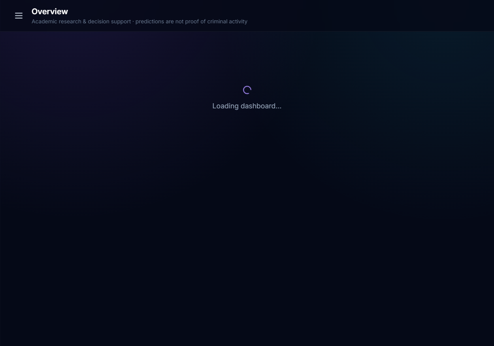
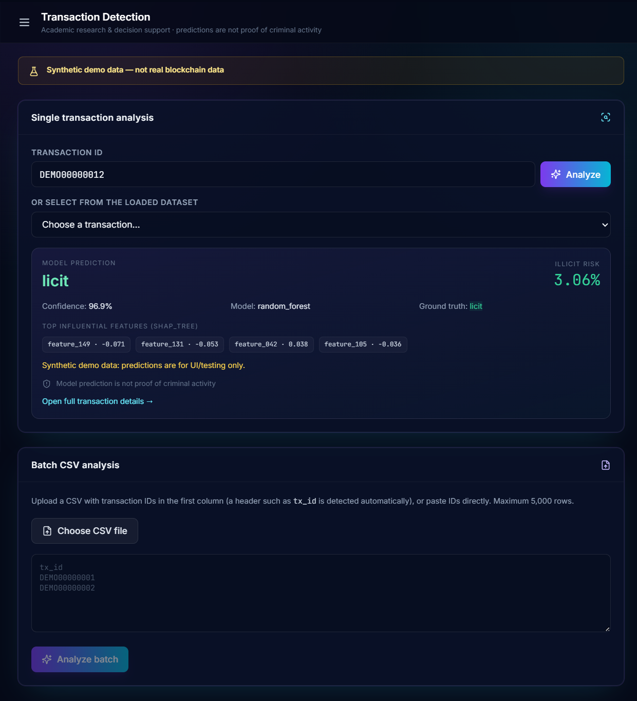
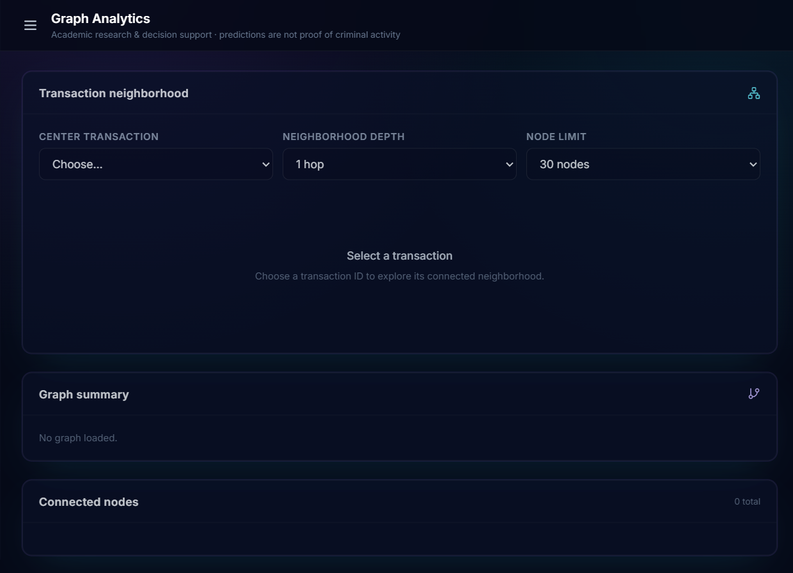
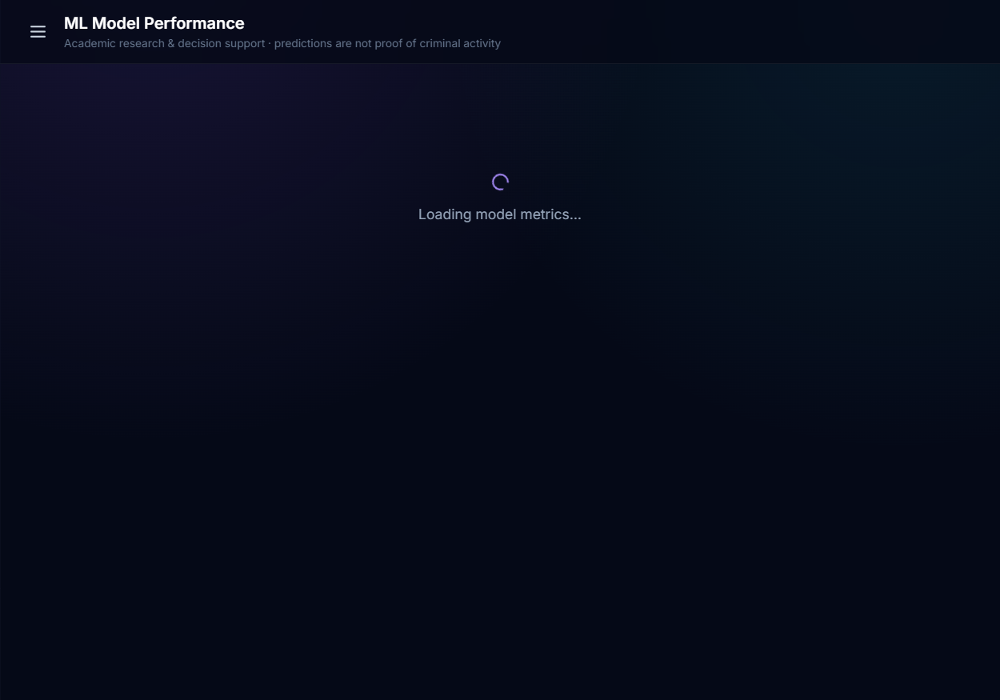

# Project Report

## Sentinel Chain — Machine Learning-Based Illicit Transaction Detection on the Bitcoin Blockchain

**Submitted by:** Alluri MadanKumar Mallikarjuna  
**Repository:** [Bitcoin-illicit-transaction-detection](https://github.com/allurimadankumar-debug/Bitcoin-illicit-transaction-detection)  

---

## Abstract

Bitcoin transactions are public but pseudonymous, which makes blockchain analysis useful for investigative support while also creating serious privacy and fairness risks. This project presents **Sentinel Chain**, a full-stack research dashboard that applies supervised machine learning to detect patterns associated with illicit Bitcoin transactions. The system combines a React/TypeScript frontend, a FastAPI backend, temporal model evaluation, NetworkX graph analytics, explainable AI, SQLite persistence, and privacy-aware handling of transaction identifiers.

The application supports two data modes. In **real-data mode**, it loads the official Elliptic Bitcoin dataset from three CSV files. In **synthetic demo mode**, which is used in this submitted environment because the Kaggle CSVs are not present, it generates deterministic labelled demo records with `DEMO########` identifiers and clearly labels every screen and API response as synthetic. A Random Forest classifier was explicitly deployed for the demo. On a chronologically held-out synthetic test split, it achieved precision, recall, F1, PR-AUC and ROC-AUC of `1.000`, with confusion matrix `[[26, 0], [0, 3]]`. These are demonstration results only and must not be interpreted as real-world detection performance.

The repository includes 27 backend tests, 8 frontend tests, a passing production build, a 13-endpoint API smoke test, architecture documentation, API documentation, Kaggle setup instructions, and screenshots of the running application.

**Keywords:** Bitcoin, Elliptic dataset, illicit transaction detection, machine learning, Random Forest, temporal split, graph analytics, SHAP, FastAPI, React, privacy.

---

## 1. Introduction

Cryptocurrencies provide transparent transaction histories but do not directly reveal the identity of the people behind addresses. This creates an important research problem: can historical transaction features and neighborhood structure help flag transactions associated with illicit activity, while keeping the output clearly limited to decision support?

The project addresses that problem by building an end-to-end system that:

1. loads and validates transaction, class and edge-list data;
2. trains and compares supervised classifiers under a chronological split;
3. reports held-out metrics with emphasis on the rare illicit class;
4. explains individual predictions using SHAP or a documented fallback;
5. displays bounded transaction neighborhoods as a graph;
6. separates ground truth from model prediction everywhere in the interface; and
7. labels synthetic demo data explicitly so it cannot be mistaken for real blockchain observations.

The application is called **Sentinel Chain** and is intended for academic demonstration, not operational law enforcement or legal evidence.

---

## 2. Objectives

| No. | Objective | Status |
| --- | --- | --- |
| 1 | Build a responsive dashboard with Overview, Detection, Explorer, Graph, Model Performance, Temporal Analytics, Privacy/Web3, Settings and Transaction Detail pages | Completed |
| 2 | Implement FastAPI endpoints for health, dashboard, transactions, prediction, graph, explanation, metrics, analytics and settings | Completed |
| 3 | Load official Elliptic CSVs with robust header, ID, missing-value and dimension handling | Completed |
| 4 | Provide a clearly labelled synthetic demo mode when real CSVs are absent | Completed |
| 5 | Train and compare multiple classifiers using a temporal train/validation/test split | Completed |
| 6 | Handle class imbalance with class weights and validation-based metrics | Completed |
| 7 | Explain predictions with SHAP where compatible | Completed |
| 8 | Keep ground truth separate from model prediction and include the mandatory warning | Completed |
| 9 | Add backend and frontend automated tests | Completed |
| 10 | Document setup, architecture, API, model methodology and results | Completed |

---

## 3. Scope and Assumptions

The project deliberately excludes several features that are outside the academic project scope:

- no wallet authentication or private-key handling;
- no storage of seed phrases, names, emails or personal identity data;
- no live blockchain lookup enabled by default;
- no graph neural networks;
- no real-time streaming ingest;
- no production cloud deployment.

The Elliptic identifiers are historical research IDs, not live Bitcoin transaction hashes. Demo identifiers such as `DEMO00000012` are generated for interface testing only. Live explorer lookup is disabled by default and requires a real 64-character hexadecimal Bitcoin transaction ID when enabled.

---

## 4. Dataset Description

### 4.1 Official Elliptic data mode

The real-data pipeline expects the following files in `data/raw/`:

```text
elliptic_txs_features.csv
elliptic_txs_classes.csv
elliptic_txs_edgelist.csv
```

The loader detects common header variants, aligns transaction IDs across files, handles missing values, validates feature dimensions and excludes unknown labels from supervised training. If the files are missing, the API and training CLI return a clear setup error pointing to `docs/KAGGLE_SETUP.md`.

Label mapping:

| Class value | Meaning | Used in supervised training |
| --- | --- | --- |
| `1` | Illicit | Yes |
| `2` | Licit | Yes |
| `unknown` | Unlabelled | No; retained for analytics |

### 4.2 Synthetic demo mode

Because the official Kaggle CSVs are not present in the submitted environment, the running application uses a deterministic synthetic dataset. This data is generated with a fixed random seed and stored under `data/processed/demo/`.

| Property | Value |
| --- | --- |
| Dataset source | `demo_synthetic` |
| Synthetic flag | `true` |
| Transactions | 359 |
| Labelled transactions | 240 |
| Illicit labelled transactions | 49 |
| Licit labelled transactions | 191 |
| Unknown / unlabelled transactions | 119 |
| Base features | 164 |
| Graph-derived features | 9 |
| Edges kept | 612 |
| Edges dropped for temporal consistency | 2 |

Every dashboard page that uses this data displays a synthetic-data banner. The API health response reports `is_synthetic: true`.

---

## 5. Methodology

### 5.1 Processing pipeline

```text
CSV files or demo generator
        |
        v
ID alignment + validation + missing-value handling
        |
        v
Feature matrix (164 base + 9 graph features)
        |
        v
Chronological split: train < validation < test
        |
        v
Class-weighted model training and calibration
        |
        v
Validation comparison -> explicit Random Forest deployment
        |
        v
Held-out test metrics + SHAP explanations
        |
        v
FastAPI services -> React dashboard
```

### 5.2 Feature engineering

The model uses the 164 numeric features supplied by the dataset format and adds nine graph-derived features calculated from a NetworkX directed graph. Edges are retained only when the source time step is earlier than or equal to the target time step. This prevents future graph structure from leaking into earlier predictions.

### 5.3 Temporal split

The data is divided chronologically:

| Split | Rows |
| --- | ---: |
| Train | 168 |
| Validation | 43 |
| Test | 29 |

The validation set is used for model comparison. The test set is scored only after the deployed model is selected. Oversampling is disabled by default; if enabled, it happens only inside training folds after the split. Class weighting is the primary imbalance strategy.

### 5.4 Models compared

| Model | Validation precision | Validation recall | Validation F1 | Validation PR-AUC |
| --- | ---: | ---: | ---: | ---: |
| Logistic Regression | 1.000 | 1.000 | 1.000 | 1.000 |
| Random Forest | 1.000 | 0.933 | 0.966 | 1.000 |
| Hist Gradient Boosting | 1.000 | 0.933 | 0.966 | 1.000 |

Automatic selection would choose Logistic Regression on this synthetic validation split because it has the same PR-AUC and higher recall. For the submitted dashboard, **Random Forest was explicitly deployed** using:

```cmd
python backend\ml\train.py --source demo --model random_forest
```

The report records this as `explicit model choice: random_forest; full validation comparison retained`, so the model choice is transparent and not misrepresented as automatic victory.

### 5.5 Calibration and explainability

Probability calibration uses a sigmoid model fitted with three-fold calibration on the training plus validation data. Individual explanations use SHAP when the deployed model is compatible; otherwise the application reports the saved global feature importance and names the fallback method explicitly.

---

## 6. System Architecture

| Layer | Technology | Responsibility |
| --- | --- | --- |
| Frontend | React 18, TypeScript, Vite, Tailwind CSS, Recharts, React Router, Lucide | Responsive dashboard and charts |
| Backend | FastAPI, Pydantic v2, Uvicorn | REST API, OpenAPI docs, validation, error handling |
| ML | pandas, NumPy, scikit-learn, optional XGBoost, optional SHAP | Dataset loading, features, training, inference, explanations |
| Graph | NetworkX | Directed graph, bounded neighborhoods, graph features |
| Storage | SQLite via SQLAlchemy | Transaction cache, predictions, metrics, history, settings |
| Privacy/Web3 | Custom validation, Web3.py-compatible txid checks | Masked IDs, redacted logs, opt-in explorer links |

### 6.1 Main API endpoints

| Method | Endpoint | Purpose |
| --- | --- | --- |
| GET | `/api/health` | Status, version, dataset source, synthetic flag, model availability |
| GET | `/api/dashboard/summary` | Aggregate counts and headline indicators |
| GET | `/api/transactions` | Filtered, sorted, paginated transaction list |
| GET | `/api/transactions/{tx_id}` | Transaction detail with features and relationships |
| POST | `/api/predict` | Single prediction with explanation and warning |
| POST | `/api/predict/batch` | Batch prediction from IDs or CSV content |
| GET | `/api/transactions/{tx_id}/graph` | Bounded colored neighborhood subgraph |
| GET | `/api/transactions/{tx_id}/explanation` | Feature attribution |
| GET | `/api/models/metrics` | Validation comparison and held-out test metrics |
| POST | `/api/models/train` | Retrain demo or Elliptic model; optional `model=random_forest` |
| GET | `/api/analytics/temporal` | Per-time-step counts and illicit rate |
| GET | `/api/analytics/risk-distribution` | Histogram of model-generated probabilities |
| GET/POST | `/api/settings` | Whitelisted preferences only; no secrets |

Prediction responses distinguish ground truth from model output. If no model is available, the response uses:

```json
{
  "predicted_class": "unknown",
  "risk_score": null,
  "confidence": 0.0
}
```

---

## 7. Implementation Details

### 7.1 Dashboard pages

| Route | Purpose |
| --- | --- |
| `/` | Overview KPIs, class mix, risk distribution, recent transactions |
| `/detect` | Single and batch prediction with explanation |
| `/explorer` | Searchable, sortable, filterable transaction table |
| `/transactions/:id` | Transaction detail, features, relationships and risk indicators |
| `/graph` | Bounded transaction neighborhood visualization |
| `/models` | Model comparison, confusion matrix, temporal metrics and retrain button |
| `/temporal` | Transaction volume and illicit-rate trends |
| `/privacy` | Privacy principles and optional explorer lookup |
| `/settings` | Safe preference controls; credentials are never accepted |

### 7.2 Safety behavior

- The exact warning `Model prediction is not proof of criminal activity` is retained in prediction responses and the interface.
- Demo data is labelled as synthetic on every relevant screen.
- Ground truth and prediction are shown as separate fields.
- Real Kaggle data is required before any real-world results can be reported.
- Kaggle credentials are not stored in `.env`, the database or API responses.

---

## 8. Results and Discussion

### 8.1 Deployed demo model

| Metric | Value | Note |
| --- | ---: | --- |
| Deployed model | `random_forest` | Explicit choice |
| Test precision, illicit | 1.000 | 3 illicit test records |
| Test recall, illicit | 1.000 | Priority metric |
| Test F1, illicit | 1.000 | — |
| Test PR-AUC | 1.000 | Priority metric for rare class |
| Test ROC-AUC | 1.000 | Secondary metric |
| Accuracy / balanced accuracy | 1.000 / 1.000 | Accuracy is informational only |
| Train / validation / test rows | 168 / 43 / 29 | Chronological split |
| Unlabelled rows | 119 | Excluded from supervised training |
| Calibration | sigmoid, 3-fold | Fitted on train + validation |
| Confusion matrix `(TN, FP, FN, TP)` | `26, 0, 0, 3` | Synthetic test split |

### 8.2 Interpretation

The perfect scores are a property of a deliberately learnable simulator, not evidence that the system detects real criminal activity. The purpose of these results is to demonstrate that the complete pipeline — loading, splitting, training, calibration, evaluation, explanation and visualization — works end to end.

The real Elliptic results table remains pending because the official Kaggle CSVs were not available in the submitted environment. Once those files are placed in `data/raw/`, the same pipeline can be run with:

```cmd
python backend\ml\train.py --source elliptic --model random_forest
```

### 8.3 Verification results

| Check | Result |
| --- | --- |
| Backend pytest suite | 27 passed |
| Frontend Vitest suite | 8 passed |
| Frontend production build | Passed |
| API smoke test | 13/13 passed |
| Health endpoint | `synthetic=True`, `model_trained=True` |
| Swagger documentation | Available at `/docs` |

---

## 9. Screenshots



*Overview — KPIs, class distribution, risk histogram, recent transactions and synthetic-data banner.*



*Detection — model prediction, risk score, SHAP-style explanation, ground truth and academic warning.*



*Graph analytics — bounded transaction neighborhood with labeled nodes.*



*Model performance — validation comparison, deployed Random Forest, confusion matrix and split metadata.*

---

## 10. Ethics and Privacy

The project follows a privacy-first design:

- no wallet connection, seed phrase, private key, name, email or IP profile is collected;
- IDs can be masked in API and UI responses;
- long identifiers are redacted from logs;
- live explorer lookup is opt-in and disabled by default;
- Elliptic IDs are not treated as live Bitcoin transaction hashes;
- predictions are never presented as proof, evidence or accusation.

Explainability is intended to describe model behavior, not human intent. A feature that influences a model does not establish why a transaction occurred.

---

## 11. Limitations and Future Work

The current system has several known limitations:

1. Synthetic demo results cannot be generalized to real Bitcoin activity.
2. The real Elliptic CSVs were not available during this submission, so real-data metrics remain pending.
3. The model uses tabular and graph-derived features, not a graph neural network.
4. The dataset is historical and does not represent present-day transaction patterns.
5. Live blockchain integration is intentionally disabled by default.
6. The production build emits a Recharts chunk-size warning but builds successfully.

Future work could include real-data evaluation, graph neural networks, temporal drift monitoring, richer explainability, and a production hosting environment with authenticated access control.

---

## 12. Conclusion

Sentinel Chain successfully demonstrates a complete academic pipeline for machine-learning-assisted analysis of illicit Bitcoin transaction patterns. It integrates robust data loading, chronological evaluation, class-imbalance handling, explainability, graph analytics and a polished responsive dashboard. The deployed Random Forest demo model and synthetic results validate that the system works end to end, while explicit labeling and safety warnings prevent those results from being mistaken for real-world findings. The project is ready for academic submission and can be switched to the real Elliptic dataset by adding the Kaggle CSVs and running the documented training command.

---

## 13. References

1. Elliptic. *Elliptic Data Set*. Kaggle. https://www.kaggle.com/datasets/ellipticco/elliptic-data-set
2. FastAPI. *FastAPI documentation*. https://fastapi.tiangolo.com/
3. React. *React documentation*. https://react.dev/
4. scikit-learn. *Machine learning in Python*. https://scikit-learn.org/
5. SHAP. *Explainable AI documentation*. https://shap.readthedocs.io/
6. NetworkX. *NetworkX documentation*. https://networkx.org/
7. Web3.py. *Python Ethereum and Web3 library*. https://web3py.readthedocs.io/
8. Vite. *Next generation frontend tooling*. https://vite.dev/

---

## Appendix A — Running the Project

### Local development

```cmd
cd "C:\Users\aluri\OneDrive\Documents\Default Project"
python -m pip install -r backend\requirements.txt
python scripts\generate_demo_data.py
python -m uvicorn app.main:app --app-dir backend --host 127.0.0.1 --port 8000
```

In a second command window:

```cmd
cd "C:\Users\aluri\OneDrive\Documents\Default Project"
npm.cmd install
npm.cmd run dev
```

Open `http://localhost:5173`.

### Host on the local network

```cmd
cd "C:\Users\aluri\OneDrive\Documents\Default Project"
npm.cmd install
npm.cmd run build
python -m pip install -r backend\requirements.txt
python scripts\generate_demo_data.py
python -m uvicorn app.main:app --app-dir backend --host 0.0.0.0 --port 8000
```

Find the IPv4 address with `ipconfig`, then open `http://YOUR_IP:8000` on another device on the same Wi-Fi.

### Verification

```cmd
python -m pytest -q
npm.cmd --prefix frontend run test
npm.cmd --prefix frontend run build
python scripts\verify_api.py
```

---

## Appendix B — GitHub Repository

```text
https://github.com/allurimadankumar-debug/Bitcoin-illicit-transaction-detection
```
