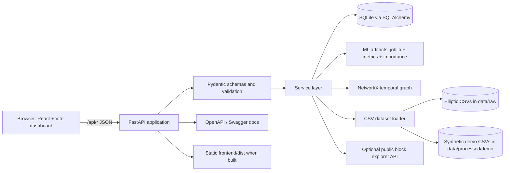
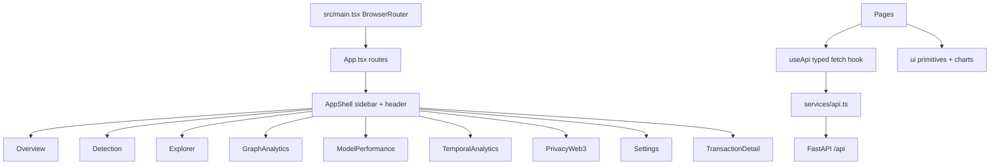

# Architecture

## 1. System overview



The system is a conventional layered application: the browser never reads CSVs, never trains models, and never holds credentials. All data access, ML inference, graph construction, and explorer lookups happen server-side.

## 2. Backend layers

### `backend/app/main.py`

- Creates the FastAPI app with a lifespan that:
  1. ensures `data/`, `models/`, and `reports/` exist,
  2. initializes SQLite tables,
  3. optionally auto-trains a synthetic model when none exists,
  4. seeds model-metric rows from the saved report,
  5. logs a redacted startup event.
- Adds CORS for configured origins.
- Registers `/api` routes, `/docs`, and `/openapi.json`.
- Installs handlers for `RequestValidationError`, `HTTPException`, and unexpected errors so clients always receive a structured `{ error, detail, status_code }` body.
- Mounts `frontend/dist/` at `/` when a production build is present.

### `backend/app/api/routes/`

Thin HTTP layer. It declares paths, query constraints, request schemas, response models, and HTTP status codes. Business logic lives in services.

| Module | Responsibility |
| --- | --- |
| `health.py` | Liveness plus dataset/model state |
| `dashboard.py` | Overview aggregates |
| `transactions.py` | List, detail, graph, explanation |
| `predictions.py` | Single/batch JSON and multipart CSV inference |
| `analytics.py` | Metrics, temporal series, risk histogram, retraining |
| `settings.py` | Safe preference GET/POST |
| `blockchain.py` | Explorer URL and opt-in live lookup |

### `backend/app/services/`

- `data.py`: cached dataset/graph access; `refresh_caches()` after retraining.
- `dashboard_service.py`: KPI aggregation from loaded data and prediction history.
- `transaction_service.py`: filtering, sorting, pagination, detail assembly, feature listing, heuristic risk indicators, explanations.
- `prediction_service.py`: validates known IDs, runs the predictor, persists predictions, produces batch results with per-row errors.
- `graph_service.py`: bounded subgraph construction and node coloring.
- `analytics_service.py`: per-time-step series, risk buckets, model-metrics formatting.
- `settings_service.py`: whitelist-backed preferences stored in SQLite.
- `explorer_service.py`: URL construction and network-disabled-by-default lookup.

### `backend/app/schemas/`

Pydantic v2 models define wire contracts. `PredictionResponse` has a fixed `warning = "Model prediction is not proof of criminal activity"`, `ground_truth_label`, `is_synthetic_data`, `is_synthetic_model_data`, and nullable `risk_score` for untrained/unknown cases.

### `backend/app/db/` and `models.py`

SQLAlchemy 2.x with SQLite by default. Tables:

- `transactions` — cached transaction metadata and scores
- `predictions` — inference history with timestamp/threshold
- `model_metrics` — per-model metric JSON
- `analysis_history` — lightweight action audit
- `app_settings` — whitelisted preference values

### `backend/ml/`

| Module | Responsibility |
| --- | --- |
| `dataset.py` | Header detection, ID alignment, label mapping, missing-value cleanup, Elliptic loader, synthetic generator |
| `preprocessing.py` | Base + graph feature bundle and chronological split indices |
| `graph_features.py` | Directed NetworkX graph, leak-free temporal edges, neighborhood extraction, graph statistics |
| `evaluate.py` | Illicit-focused metrics, model selection, plots, JSON report |
| `train.py` | Candidate training, validation selection, final retrain, calibration, artifact persistence |
| `predict.py` | Loads `model_bundle.joblib`, gracefully handles no model, returns probabilities and metadata |
| `explain.py` | SHAP Tree/Linear explainer when compatible; global-importance fallback otherwise |

Artifacts:

```text
models/model_bundle.joblib       # fitted pipeline, feature names, metadata
models/model_metrics.json        # comparison, split, dataset info, test metrics
models/feature_importance.json   # ranked global importances + method
reports/model_comparison.png     # metric chart
reports/confusion_matrix.png     # test confusion matrix
reports/precision_recall.png     # PR curve
```

All generated artifacts are git-ignored.

## 3. Data flow

### Request: dashboard overview

1. Frontend calls `GET /api/dashboard/summary` through the Vite proxy or same-origin static mount.
2. `get_dataset()` resolves source (`auto`, `elliptic`, or `demo`) and caches the loaded `TransactionDataset`.
3. `get_dashboard_summary()` aggregates class counts and reads prediction/model metadata.
4. Pydantic serializes a typed response; React renders KPI cards and charts.

### Request: prediction

1. `POST /api/predict` validates the ID (64-hex Bitcoin txid or opaque dataset ID) and threshold.
2. `predict_transaction()` checks the dataset, computes the same base + graph features used in training, and invokes the saved pipeline.
3. If no model exists: `predicted_class = "unknown"`, `risk_score = null`, `confidence = 0.0`, plus a training instruction. No score is fabricated.
4. If a model exists: illicit probability is thresholded, an explanation is generated, metadata is persisted to SQLite, and the response includes the mandatory warning.
5. The UI shows ground truth and model prediction separately.

### Training

1. `load_dataset(source=...)` returns a validated dataset.
2. `build_feature_bundle()` creates numeric features including graph statistics.
3. `temporal_split()` partitions labelled rows by time.
4. Candidate models are evaluated on validation only; class weights are applied to training folds.
5. `select_best_model()` ranks by PR-AUC, then recall, then F1.
6. The selected architecture is retrained on train+validation, optionally calibrated, and evaluated once on test.
7. Artifacts are saved and caches are refreshed.

## 4. Frontend architecture



- `services/api.ts` is the single HTTP client; `BASE_URL` can be overridden with `VITE_API_URL`.
- `useApi` owns loading/error/refetch state so pages degrade gracefully when the backend is offline.
- `types/index.ts` mirrors server response contracts.
- `components/ui/` contains shadcn-style primitives (Card, Button, Badge, fields, feedback).
- `components/charts/` wraps Recharts and the custom SVG graph renderer.
- Synthetic-data banners and academic warnings are rendered at page and detail level.

## 5. Deployment topology

### Local development

```text
:5173 Vite dev server --proxy /api --> :8000 FastAPI
```

### Docker Compose

- `backend` builds React first, copies `frontend/dist/` into the Python image, then serves API + compiled UI on `:8000`.
- `frontend` runs Vite on `:5173` with `VITE_API_PROXY=http://backend:8000`.
- Volumes persist `data/`, `models/`, and `reports/` across container rebuilds.

### Privacy boundary

The only external network call is the opt-in explorer lookup. It is disabled by default, validates Bitcoin txids, never receives keys, and is explicitly separated from historical Elliptic IDs. Logs redact long identifiers. Settings reject unknown keys, so credentials cannot be stored through the API.
